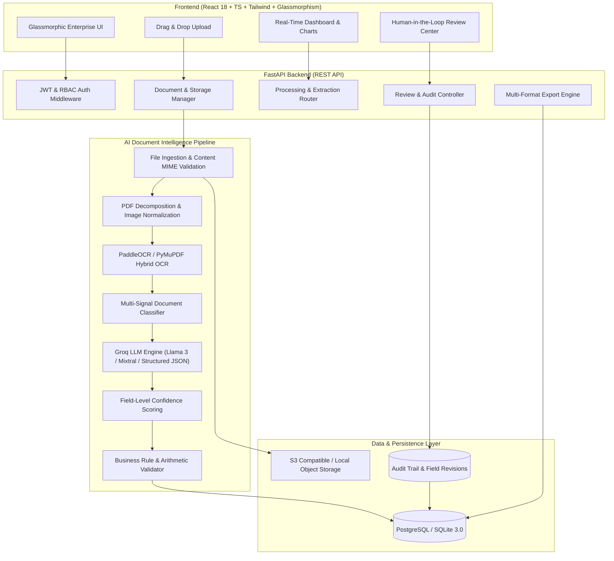

# DocuMind AI: System Architecture

## Architecture Principles
1. **Modular AI Decoupling**: OCR engines (PaddleOCR, PyMuPDF, OCR fallback) and LLM inference engines (Groq API, Ollama, OpenAI-compatible) are decoupled behind abstract interfaces (`BaseOCREngine`, `BaseExtractionEngine`).
2. **Deterministic Evidence & Grounding**: Every extracted entity preserves source page, source text snippet, bounding box coordinates (where available), and granular confidence metrics.
3. **Immutability of Raw Extraction**: Human edits never overwrite raw extraction runs; edits are recorded in `field_corrections` with user attribution and timestamp.
4. **Resilient Local & Cloud Portability**: Automatically runs locally using SQLite and disk storage, while seamlessly scaling to PostgreSQL and S3 on cloud deployments.
